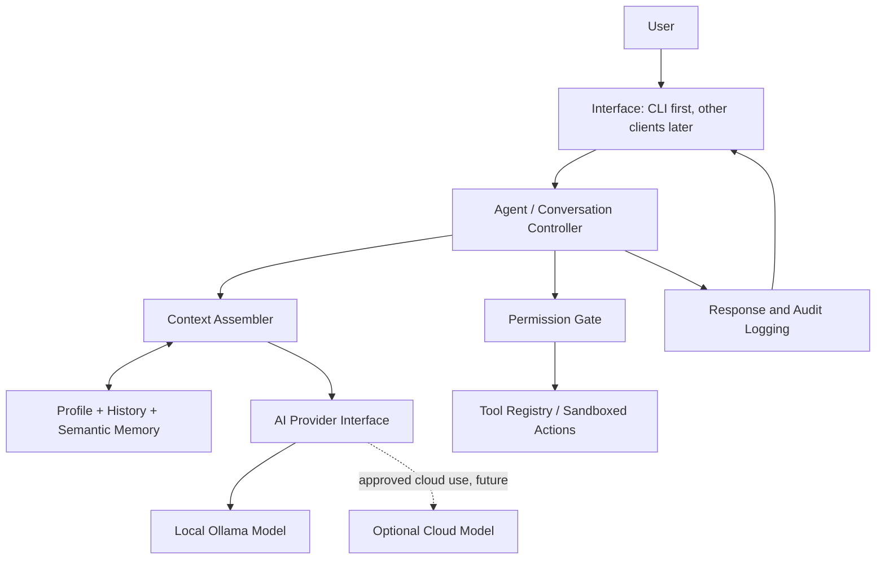

# Echo — Initial Technical Architecture

**Baseline:** v0.0.1 · **Status:** Agreed target architecture; only the CLI scaffold exists.

**Authority:** The private `Echo_Master_Document.md` (specification v1.3) defines product goals, required capabilities, and milestone completion criteria. This document records the **implementation choices** for those goals.

## Data flow (target)



## Decisions

1. **Entry point:** `src/echo.js` loads configuration, selects the active phase, and starts the chosen interface. It does not implement language-model logic.
2. **Phases:** `src/phases/phase-00.js` ... `phase-05.js` document/start milestone integrations. All versions share reusable modules; we will not clone the whole agent into each new phase.
3. **Language/runtime:** Node.js 24 with JavaScript ES modules. Keep Python optional for libraries that need it.
4. **Interface:** CLI first. Later desktop and Android clients interact with the agent through an explicit, authenticated interface, not directly with memory files.
5. **LLM adapter:** a provider interface abstracts Ollama now and opt-in cloud inference later. Local inference must remain available without internet.
6. **Memory:** separate profile, conversation history and semantic note retrieval. Start with private local files for an initial prototype; introduce SQLite for structured persistence and a vector index for semantic retrieval when implemented.
7. **Actions:** the model may **propose** an action, but only application code can execute it after policy evaluation. Default-deny for high-impact actions; log results and allow cancellation.
8. **Cloud boundary:** no personal information leaves the device without explicit permission. Multi-device encrypted synchronization belongs to Phase 3, not Phase 0.
9. **Device limits:** evaluate small quantized models against the existing 8 GB RAM laptop; do not promise sub-2-second latency before measurement.
10. **Private data:** secrets, profile, conversation logs, recordings, indexes, and databases live in ignored local paths and can be exported/deleted by design.

## Module ownership

| Path | Responsibility | First milestone |
| --- | --- | --- |
| `src/echo.js` | Bootstrapping and startup | Scaffold |
| `src/phases/` | Milestone registration and wiring | Scaffold |
| `src/interfaces/` | Text CLI, later other client adapters | Phase 0 |
| `src/core/` | Dialogue, context assembly, policy and audit interfaces | Phase 0/1 |
| `src/providers/` | Ollama and optional other model adapters | Phase 0 |
| `src/memory/` | Profile, notes, retrieval and later persistence | Phase 0 |
| `src/tools/` | Capability registry and permissioned execution | Phase 1+ |
| `docs/phases/` | Roadmap and acceptance criteria | Scaffold |
| `data/` | Local state, ignored | Phase 0 |

## Phase 0 interfaces (planned, not implemented)

```text
interface AIProvider {
  generate({ messages, context }): Promise<{ text }>
}
interface MemoryRepository {
  getProfile(): Promise<Profile>
  searchNotes(query, limit): Promise<Note[]>
  addNote(note): Promise<void>
}
interface PermissionGate {
  authorize(action): Promise<{ allowed, reason }>
}
```

These are **conceptual contracts**, not actual JavaScript type declarations or working code.

## Phase 0 acceptance criteria

- CLI accepts conversation input and returns a real local LLM response.
- Replies use an explicitly loaded private profile/personality context.
- Notes can be stored and semantically retrieved in an offline session.
- A daily routine summary can be requested from locally available information.
- Disabling internet does not break the defined Phase 0 core.
- Failure states (missing model, corrupted data) are handled without leaking secrets.

## Security gates before autonomous tools

Do not grant filesystem write, shell execution, network transmission, telephony, or messaging permissions to AI-generated requests until there are explicit permission checks, bounded access, audit records, and tests. Phase 3 autonomy inherits these safeguards; it does not bypass them.
