# Echo — Personal AI Agent (Digital Twin)
## Master Project Document

**Version:** 1.4 (Public Technical Specification)  
**Updated:** 26 October 2026  
**Maintainer:** Project maintainer (not identified in this public document)  
**Status:** Public design specification; private profile removed  
**Source:** Public technical requirements based on specification v1.3; no populated or template personal profiles included

---

## Public specification and privacy

This public document contains technical requirements and roadmap only. Populated user profiles, personal preferences, location, contact details, private device identification, and historical feedback belong in local private files and must not be committed.

Requirements and architecture diagrams are **planned design** unless the release README explicitly identifies the feature as implemented and tested.

---

# PART 1 — PERSONAL AI AGENT SPECIFICATION

> **Requirements, Specifications, System Architecture & Building Phases**  
> **Version:** 1.3  
**Date:** 22 October 2026  
**Maintainer:** Project maintainer (not identified in this public document)  
**Status:** Design Specification  
**Updates:** Security, multi-device sync and decision-support designs; see current release for implementation status  

---

## 1. Vision Statement

Create an autonomous, hybrid (offline-first + online-capable) Personal AI Agent that functions as a digital version of the user. The agent assists with daily routines, holds natural human-like conversations, makes and answers phone calls, summarizes notes, writes and executes code, generates ideas, and supports decision-making — all while adapting to the user’s personal style, values, and preferences.

---

## 1.1 Recommended Name & Voice

### Suggested Name: **Echo**

**Why “Echo”?**
- Represents a true digital reflection / twin of you.
- Short, memorable, easy to say and call (“Hey Echo”).
- Neutral yet strong — works for both casual and professional contexts.
- Implies listening and responding intelligently.
- Available and brandable.

**Alternative strong options:**
| Name     | Feel                          | Best For                  |
|----------|-------------------------------|---------------------------|
| **Echo** | Reflection, intelligent twin  | Recommended primary      |
| Aether   | Subtle, elevated presence     | More premium / elegant   |
| Kai      | Modern, sharp, short          | Fast daily interactions  |
| Forge    | Builder, maker, action       | Coding + decision focus  |
| Nyx      | Quiet strength, night/day     | Always-on companion      |

**Recommendation:** Start with **Echo**. You can always rename later.

### Configurable private voice settings

Voice, pitch, accent and language selections are private local settings. No personally distinctive voice profile is published here. A local TTS/STT implementation must be hardware-tested before it is advertised as operational.

---

## 2. Requirements

### 2.1 Functional Requirements

| ID | Requirement | Priority | Notes |
|----|-------------|----------|-------|
| FR-01 | Maintain a persistent personal profile and memory of the user’s preferences, decision style, communication tone, goals, and past interactions | Must | Core of “digital me” |
| FR-02 | Assist with daily routine: calendar awareness, task prioritization, proactive reminders, morning/evening briefings | Must | |
| FR-03 | Hold natural, multi-turn human conversations (text and voice) that feel consistent with the user’s personality and context | Must | New explicit requirement |
| FR-04 | Summarize notes (text, voice recordings, documents) into structured summaries with action items | Must | |
| FR-05 | Generate, explain, and optionally execute code in a sandboxed environment | Must | |
| FR-06 | Suggest ideas and help make decisions by presenting options, trade-offs, and recommendations aligned with the user’s values | Must | |
| FR-07 | Make outbound phone calls and answer inbound calls using natural conversation | Should | High complexity |
| FR-08 | Operate fully offline for core functions; enhance capabilities when online | Must | Offline-first |
| FR-09 | Act autonomously: plan, monitor, execute, and follow up on tasks with minimal user prompting | Must | With approval gates |
| FR-10 | Continuously learn from user feedback and update personal profile and memory | Should | |
| FR-11 | Provide transparent logs of all autonomous actions and reasoning | Must | |
| FR-12 | Support multi-device continuity (phone + computer) | must | |

### 2.2 Non-Functional Requirements

| ID | Requirement | Target |
|----|-------------|--------|
| NFR-01 | Offline capability | Core functions available without internet |
| NFR-02 | Latency (text conversation) | Aspirational; measure on target hardware (CPU-only full responses can be much slower) |
| NFR-03 | Latency (voice conversation) | Aspirational; verify STT + inference + TTS latency on-device |
| NFR-04 | Privacy | All personal data stored and processed locally by default; cloud use minimized and encrypted |
| NFR-05 | Security | End-to-end encryption for any sync; approval required for high-impact actions |
| NFR-06 | Battery & resource efficiency | Optimized for continuous background operation on mobile |
| NFR-07 | Reliability | Graceful degradation when models or connectivity fail |
| NFR-08 | Extensibility | Modular tool and model architecture |

## Cross-Platform and Offline-First Requirements

### 1. Supported Platforms and Hardware

Echo must support the following platforms:

- **Windows:** Desktop development and assistant access.
- **Ubuntu Linux:** Primary development environment and assistant access.
- **Android:** Mobile assistant access.

Initial development hardware:

- **Computer:** An entry-level CPU-only Linux/Windows device, including 8 GB RAM targets.
- **Mobile device:** A resource-constrained Android device; test each target independently.

The Android operating-system version and available storage must be verified on the actual device before finalizing compatibility and performance decisions.

### 2. Independent Device Operation

- Echo must remain usable on a supported device when the other devices are switched off or unavailable.
- Basic assistant functionality must not depend on the user's computer being powered on.
- Each supported device must have access to the local resources required for its supported offline capabilities.
- The system must distinguish between locally available features and features that require a remote service.

### 3. Offline-First Functionality

When internet connectivity is unavailable, Echo should support the following on each compatible device:

- Text conversations using a locally available AI model.
- Access to locally stored conversations and approved memories.
- Persistent local data across application restarts.
- Core functionality that does not require cloud services or remote APIs.
- Clear error handling for features that cannot operate offline.

Offline capabilities must be tested on the actual target hardware. Features that require internet connectivity must be identified and documented explicitly.

### 4. Resource-Aware AI Execution

- Select AI models according to each device's physical RAM, processor, storage capacity, thermal limits, and acceptable response time.
- Prefer appropriately sized, quantized models for resource-constrained devices.
- Do not treat extended or virtual RAM as equivalent to physical RAM.
- Benchmark candidate models on the actual hardware before declaring them supported.
- Keep model files, application data, and local databases within reasonable storage limits.
- Avoid configurations that make the device unstable or significantly impair normal operation.

### 5. Local Memory and Cross-Device Synchronization

- Each device must retain its own usable local memory and conversation history.
- Basic memory access must not require an active internet connection.
- Changes made offline must remain locally available until synchronization becomes possible.
- When a permitted communication path becomes available, Echo should synchronize eligible changes through a secure internet service or a supported direct local connection.
- Synchronization must account for duplicate records, conflicting edits, updates, and deletions.
- Synchronization must respect the existing privacy, authorization, and approval policies.
- Sensitive information must not be transmitted to external services without the required authorization.

### 6. Connectivity and Privacy

- Echo must distinguish between offline, local-network, and internet-connected operation.
- The absence of internet connectivity must not prevent access to locally available conversations and approved memories.
- Remote services must not be assumed to be available at all times.
- External communication and sensitive-data sharing must follow Echo's existing approval policies.
- Any cloud-based functionality must be documented separately from local functionality.

### 7. Acceptance Criteria

The future cross-platform offline implementation is considered complete only when testing demonstrates that:

- Echo can conduct a basic text conversation on each supported platform without internet access.
- Approved local memories remain accessible offline and persist after application restarts.
- Each device remains independently usable while the other devices are switched off.
- Local functionality handles unavailable remote services gracefully.
- Changes made offline can be synchronized when a permitted communication path becomes available.
- Synchronization handles conflicting changes and deletions according to documented rules.
- AI performance and storage consumption are measured on the actual Windows, Ubuntu, and Android hardware.
- Privacy and approval policies remain enforced in both offline and connected operation.

### 2.3 Conversation-Specific Requirements (Human-like Dialogue)

- Support natural, multi-turn conversations in both text and voice.
- Maintain conversation context across sessions and devices.
- Match the user’s communication style, vocabulary level, and tone.
- Handle interruptions, topic shifts, clarifications, and emotional cues appropriately.
- Distinguish between casual chat, task-oriented dialogue, and deep decision support.
- Support both proactive initiation of conversation and reactive responses.
- Provide clear indicators when the agent is speaking as “digital you” versus giving neutral information.

---

## 3. Specifications

### 3.1 Core Capabilities

1. **Personal Memory & Profile**
   - Structured profile (values, decision principles, communication preferences, recurring contexts).
   - Vector memory (notes, past decisions, conversations, code preferences).
   - Feedback loop for continuous personalization.

2. **Natural Conversation Engine**
   - Text and voice modalities.
   - Context window management + long-term memory retrieval.
   - Personality and style consistency layer.
   - Emotion and intent detection (lightweight).

3. **Daily Routine Engine**
   - Calendar and task integration.
   - Proactive scheduling and prioritization.
   - Morning briefing and evening review generation.

4. **Note Intelligence**
   - Voice-to-text + summarization.
   - Action item extraction and follow-up tracking.

5. **Coding Assistant**
   - Code generation, explanation, debugging.
   - Local sandbox execution with safety constraints.

6. **Decision & Ideation Support**
   - Multi-option analysis.
   - Alignment with personal values and past decisions.
   - Idea generation scored against user goals.

7. **Telephony**
   - Outbound call initiation with confirmation.
   - Inbound call handling with conversation management.
   - Fallback to “notify user” mode.

8. **Autonomy Layer**
   - Planner → Executor → Reflector loop.
   - Permissioned tool use.
   - Scheduled background checks.
   - Kill-switch and approval gates.

### 3.2 Technical Specifications

| Component | Recommended Technology | Notes |
|-----------|------------------------|-------|
| Local LLM Runtime | Ollama / llama.cpp / on-device (MLX / Android) | Quantized models sized to each device; 1B–3B may be realistic on 8 GB CPU-only systems |
| Cloud LLM (optional) | Stronger models via API or self-hosted | Used only when beneficial |
| Vector Memory | Chroma / LanceDB / SQLite + embeddings | Local-first |
| Speech-to-Text | Whisper.cpp or on-device STT | Offline capable |
| Text-to-Speech | Piper / Coqui / system TTS | Low-latency local |
| Agent Framework | Lightweight custom loop or LangGraph / CrewAI | Runnable locally |
| Telephony | Twilio (or equivalent SIP) | Online only |
| Mobile Frontend | Flutter or React Native (Android priority) | Background services |
| Desktop Frontend | Electron / Tauri or native | |
| Sync | End-to-end encrypted local-first | When online |
| Code Sandbox | Restricted local execution environment | Safety critical |

### 3.3 Data & Privacy Specifications

- Default: all personal data remains on-device.
- Cloud transmission only with explicit user consent and encryption.
- No third-party training on private user data without opt-in.
- Full action audit log retained locally.
- User can export or delete all personal data at any time.

---

## 4. System Architecture

### 4.1 High-Level Architecture

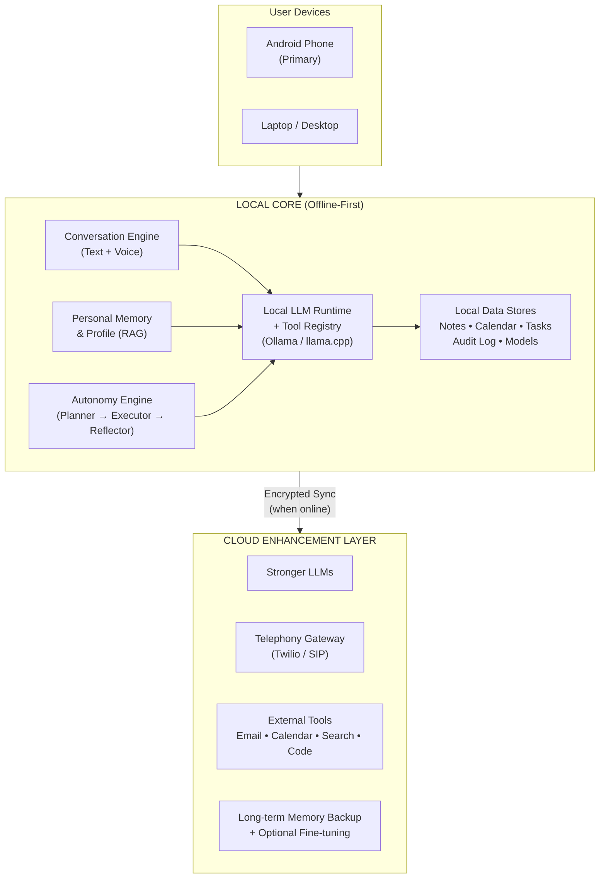

### 4.2 Key Architectural Principles

- **Offline-first**: The long-term Local Core must deliver essential capabilities without internet; current coverage is limited to supported local modules.
- **Modular**: Conversation, Memory, Autonomy, and Tools are loosely coupled.
- **Permissioned Autonomy**: High-impact actions (calls, external messages, irreversible changes) require explicit or pre-approved consent.
- **Graceful Degradation**: When cloud or advanced models are unavailable, the system falls back to local models and simpler rules.
- **Personality Consistency**: A dedicated style/personality layer sits between the raw LLM and the user-facing conversation.

### 4.3 Conversation Architecture (Detailed)

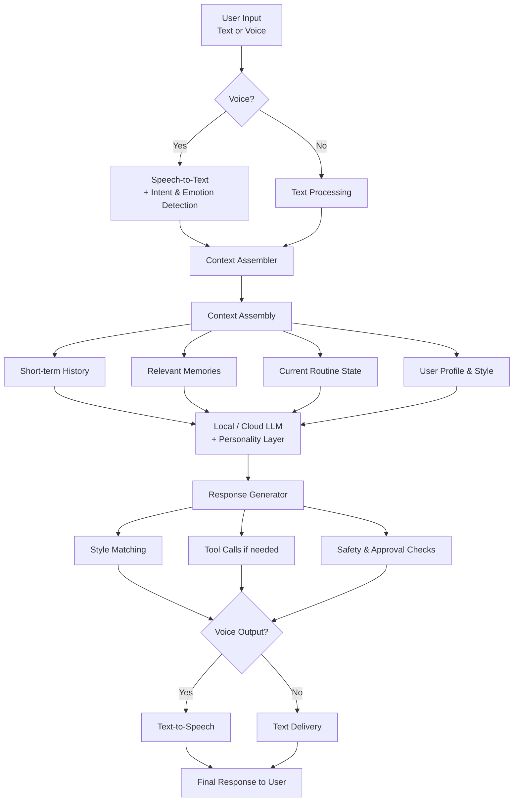

### 4.4 Autonomy Loop Architecture

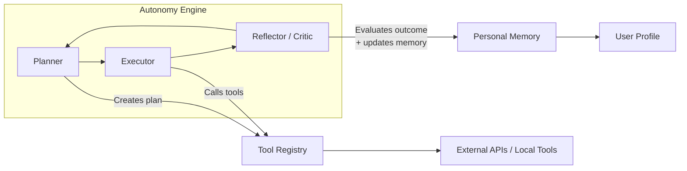

### 4.5 Data Flow & Privacy Boundaries

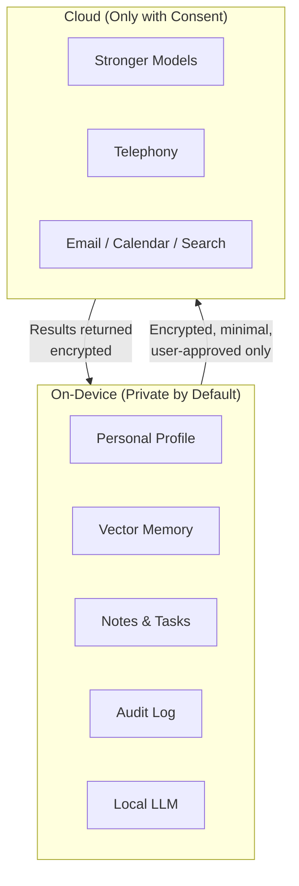

### 4.6 Building Phases Roadmap

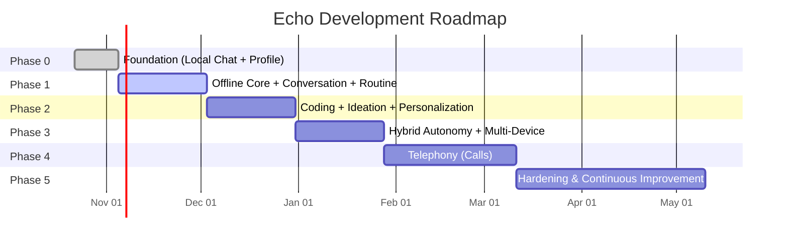

### 4.7 Daily Routine Flow

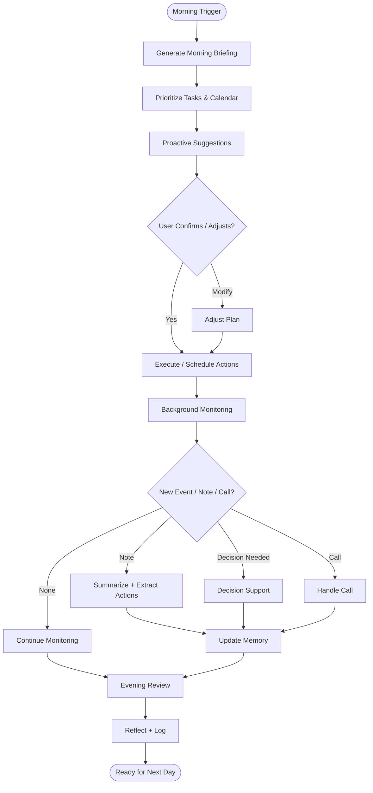

### 4.8 Telephony Call Flow

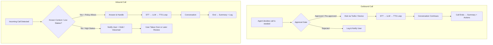

### 4.9 Memory & Personalization Cycle

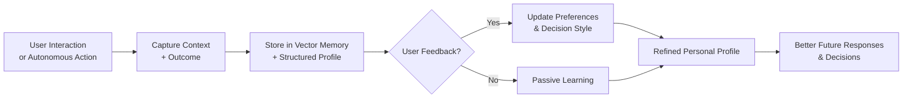

### 4.10 Component Interaction Overview

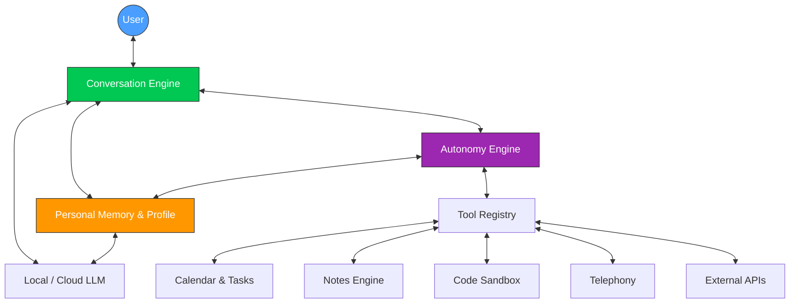

### 4.11 Security Model

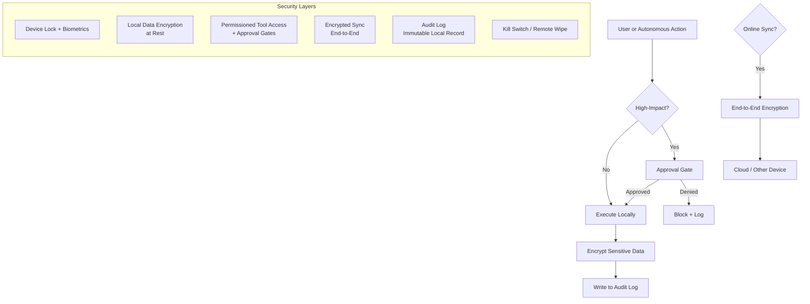

**Security Principles:**
- Least privilege for every tool
- Explicit consent for high-impact actions (calls, external messages, deletions, financial)
- Encryption at rest (future requirement; not yet delivered for local JSON stores)
- Future sync must be E2E encrypted; sync is not yet implemented
- Future autonomous actions must have an auditable trail; autonomy is not implemented
- Revocation and secure deletion must be implemented before remote actions are enabled

### 4.12 Multi-Device Sync Architecture

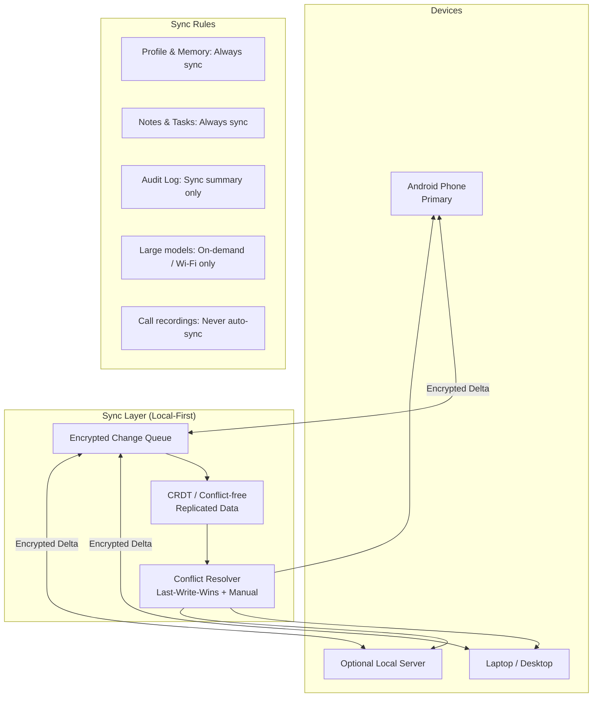

**Multi-Device Principles:**
- Local-first: each device works fully offline
- Only deltas (changes) are synced
- Conflict resolution prefers the most recent meaningful update
- User can force “phone is source of truth” or manual merge
- Sensitive data (call audio, raw voice notes) stays device-local unless explicitly shared

### 4.13 Decision-Making Flow

```mermaid
flowchart TD
    Trigger[Decision Request<br/>or Proactive Need] --> Gather[Gather Context]
    Gather --> G1[Current Goals]
    Gather --> G2[Relevant Past Decisions]
    Gather --> G3[Constraints & Values]
    Gather --> G4[Available Options / Data]

    G1 & G2 & G3 & G4 --> Analyze[Analyze Options]
    Analyze --> Score[Score against<br/>User Values & Goals]
    
    Score --> Present[Present to User]
    Present --> P1[Clear Options]
    Present --> P2[Trade-offs]
    Present --> P3[Recommendation<br/>+ Reasoning]
    Present --> P4[Confidence Level]

    P1 & P2 & P3 & P4 --> UserChoice{User Decision}
    UserChoice -->|Accepts Recommendation| Execute[Execute / Log]
    UserChoice -->|Chooses Alternative| Execute
    UserChoice -->|Requests More Info| Gather
    UserChoice -->|Defers| Park[Park Decision<br/>+ Reminder]

    Execute --> Feedback[Capture Outcome<br/>+ User Feedback]
    Feedback --> Learn[Update Decision Style<br/>in Personal Profile]
```

**Decision Support Rules:**
- Always show reasoning in Echo’s voice
- Never hide uncertainty
- Prefer options that align with stated long-term goals
- After important decisions, ask for short feedback to improve future recommendations

---

## 5. Building Phases

### Phase 0 – Foundation (Week 1–2)
**Goal:** Basic local chat interface + personal profile.

- Install local LLM runtime (Ollama recommended).
- Create structured personal profile document.
- Implement simple vector store for notes.
- Build text-based conversation interface.
- Deliver daily routine summary on demand.

**Exit Criteria:** User can chat with a local model that already reflects basic personal style and can retrieve personal notes.

### Phase 1 – Offline Core + Routine + Conversation (Week 3–6)
**Goal:** Fully functional offline personal assistant with natural conversation.

- Robust multi-turn conversation engine with context and style matching.
- Calendar and task integration.
- Proactive morning/evening briefings.
- Voice input/output (local STT/TTS).
- Note capture and summarization.
- Basic decision-support prompts.

**Exit Criteria:** Agent holds coherent human-like conversations offline and manages daily routine autonomously within defined bounds.

### Phase 2 – Coding, Ideation & Deeper Personalization (Week 7–10)
**Goal:** Advanced cognitive assistance.

- Code generation + local sandbox execution.
- Idea generation and scoring against personal goals.
- Decision journal with feedback loop into profile.
- Improved long-term memory and retrieval.

**Exit Criteria:** Agent can help write and run code, generate useful ideas, and improve its decision recommendations based on user feedback.

### Phase 3 – Hybrid Autonomy & Multi-Device (Week 11–14)
**Goal:** True autonomous behavior with online enhancement.

- Background agent loop (Planner → Executor → Reflector).
- Encrypted multi-device sync.
- Online tool use (email, search, external calendars) when beneficial.
- Comprehensive action logging and approval gates.

**Exit Criteria:** Agent proactively manages tasks across devices and uses cloud resources only when they add clear value.

### Phase 4 – Telephony (Week 15–20)
**Goal:** Make and answer phone calls with natural conversation.

- Outbound calling with user confirmation.
- Inbound call handling with conversation management.
- Integration of STT/TTS + LLM dialogue for calls.
- Robust fallback and notification modes.
- Extensive testing for latency, noise, and consent.

**Exit Criteria:** Agent can conduct useful phone conversations in approved scenarios while remaining transparent and controllable.

### Phase 5 – Hardening, Optimization & Continuous Improvement (Ongoing)
**Goal:** Production-grade reliability and deeper personalization.

- Performance and battery optimization.
- Optional privacy-preserving fine-tuning on user data.
- Advanced guardrails and monitoring.
- Expanded tool ecosystem.
- Continuous evaluation of conversation quality and autonomy safety.

---

## 6. Success Metrics

| Area | Metric | Target |
|------|--------|--------|
| Conversation Quality | User rates interaction as “feels like me / natural” | ≥ 4.2 / 5 |
| Offline Reliability | Core features work without internet | 100% of defined core set |
| Autonomy Usefulness | Tasks completed or advanced without manual intervention | Increasing trend |
| Privacy | Personal data leaving device without consent | 0 |
| Call Handling | Successful natural conversation completion rate | ≥ 80% in pilot scenarios |
| User Trust | Willingness to grant higher autonomy over time | Increasing |

---

## 7. Risks & Mitigations

| Risk | Mitigation |
|------|------------|
| Conversation feels generic or inconsistent | Strong personality/style layer + continuous feedback |
| Autonomy causes unwanted actions | Strict approval gates + full audit log + kill-switch |
| Telephony latency or unnatural dialogue | Hybrid scripted + LLM approach; start narrow |
| Privacy leakage | Local-first design + encryption + minimal cloud use |
| Model hallucination in decisions | Force citation of personal memory + explicit uncertainty |
| Battery drain on phone | Aggressive quantization, scheduled inference, efficient wake locks |

---

## 8. Current implementation actions

1. Keep the working Phase 0 baseline stable: local chat, note retrieval, private profile and basic routine summary.
2. Verify the Phase 1 release candidate on actual CPU-only Ubuntu hardware, using the acceptance checklist.
3. Install and test optional local speech tools before claiming voice is operational.
4. Improve factual grounding, multi-turn dialogue reliability, calendar delivery and permission boundaries.
5. Keep synchronization, telephony, autonomous external actions and encrypted storage in planned scope until separately implemented and verified.

---

**Document Control**

This public document defines project goals. Release documentation defines actually implemented capabilities. All implementation work should trace back to the requirements and phases defined herein.

*End of Specification*

---

---

# Appendix — Implementation status and repository privacy

## Implemented and pending

- Phase 0: local chat, user-configurable private profile, explicit notes and semantic retrieval, manual tasks, on-demand routine report.
- Phase 1: offline command routing, local event calendar, briefings, extractive summaries, deterministic games, optional offline voice adapters. These have simulated automated tests; actual voice and model accuracy have not been accepted on target hardware.
- Phases 2–5 and cross-device synchronization remain planned, including encryption and autonomous actions.

## Public repository controls

- Keep `.env`, `config/profile.json`, `data/`, recordings and raw personal logs outside Git.
- Never publish real personal profiles, email addresses, phone numbers, location histories, credentials or secret tokens.
- Private study preferences and other individualized instructions belong in a local profile, not in this document.
- Local note and calendar JSON stores currently have operating-system permission restrictions, **not** encryption at rest.

## Git history and privacy caution

A previous Git commit contained the more detailed master document with a populated personal profile. Replacing the file in a later commit **does not delete the earlier version from Git history**, GitHub mirrors or clones. Removing historical content requires a separate, explicitly authorized Git history remediation procedure; this update does not rewrite commit history or modify other historical commits.
