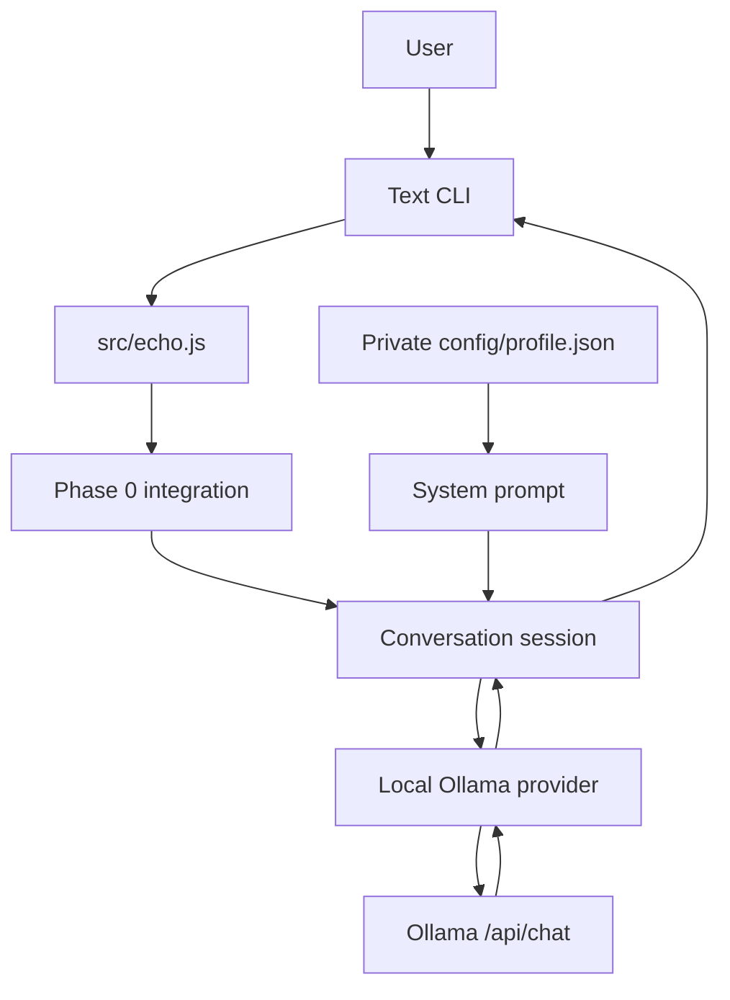

# Echo — Initial Technical Architecture

**Baseline:** v0.0.2 · **Status:** Milestones 0.2 and 0.3 implemented, Phase 0 not complete.  
**Authority:** `Echo_Master_Document.md` specification v1.3 (private project reference).

## Working Phase 0 flow

## Component ownership

| Module | Responsibility |
| --- | --- |
| `src/echo.js` | Startup and dependency wiring, no LLM business logic |
| `src/phases/phase-00.js` | Phase registry and integration point |
| `src/interfaces/cli.js` | User input, commands, terminal output |
| `src/core/config.js` | Local configuration, only loopback model endpoints allowed |
| `src/core/conversation.js` | Assemble system prompt and recent dialogue, bounded RAM history |
| `src/memory/profile.js` | Load and validate private personal profile; build style context |
| `src/providers/ollama.js` | HTTP adapter to local Ollama `/api/chat` |
| `src/memory/` (future) | Persistent notes and semantic retrieval |
| `src/tools/` (future) | Permission-gated capabilities, not yet enabled |

## Current boundaries

1. No third-party npm runtime dependencies. Node.js 24 standard APIs are sufficient.
2. Ollama is addressed only via a local loopback HTTP address by default and enforced by `readConfig` in application startup.
3. The user's profile is injected into the model's system context but is not transmitted to a cloud model by this implementation.
4. CLI dialogue is **not written to disk** and is forgotten after app restart (or `/reset`).
5. Config and profile are both local files. `.env`, `config/profile.json`, model weights, and `data/` must be Git-ignored.
6. No autonomy, code execution, filesystem tool access, note saving, or telephony exists yet.
7. `fetch` errors and model 404 responses are handled without printing private profile or user messages.

## Next work

- **0.4:** persistent notes + local embeddings + vector search, independent of the model/provider.
- **0.5:** on-demand daily routine summary and Phase 0 offline end-to-end tests.
- Later phases expand interfaces and action capabilities through explicit permissions and audit logs.
